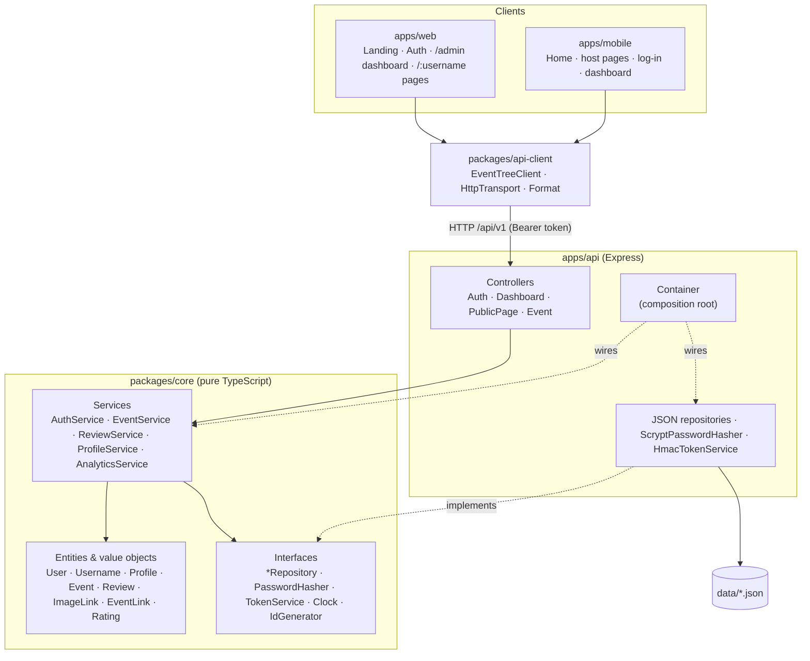

<div align="center">

# 🎟️ Event Tree

### One link for every event you host.

A link-in-bio platform for events, built the way Linktree works: claim a name, get a page at
`/yourname`, and manage it from a dashboard with a live phone preview. Instead of links, your page
lists **events**. Upcoming ones count down, past ones keep their photos and reviews.

One TypeScript codebase for a **web app**, a **mobile app** and the **API** behind both.


[How it works](#-how-it-works) · [Features](#-features) · [Tech stack](#-tech-stack) · [Architecture](#-architecture) · [Repo structure](#-repository-structure) · [OOP design](#-object-oriented-design) · [Quick start](#-quick-start) · [API](#-api-reference)

</div>

---

## 🧭 How it works

Event Tree copies how Linktree works, not how it looks. It has its own name, logo, colours and type,
and every Linktree feature has an event version:

| Linktree | Event Tree |
|---|---|
| Claim `linktr.ee/yourname` on the home page | Claim `/yourname` on the landing page, with a live "is it free?" check |
| Admin: a list of link cards with toggles and drag handles | `/admin`: a list of **event cards** with a show/hide switch, up/down reorder, edit and delete |
| Live phone preview beside the editor | The same: the real public page in a phone frame, reloaded after each save |
| Appearance: themes, button styles, fonts, colours | Six themes, four button styles (**ticket stub**, pill, outline, hard shadow), three fonts, custom colours |
| Social icons under the bio | Instagram, X, TikTok, YouTube, LinkedIn, Facebook, WhatsApp, website |
| Insights: views, clicks, click rate | `/admin/analytics`: views and clicks per day, click rate, most-clicked events |
| A link button | An **event ticket**: poster, title, venue, and a perforated date stub |
| (nothing) | Upcoming/Past sorts itself, countdowns, photo galleries, star reviews |

The full reverse-engineering notes are in [docs/reverse-engineering/linktree.md](docs/reverse-engineering/linktree.md).

---

## ✨ Features

| | Feature | Where |
|---|---|---|
| 🙋 | **Accounts.** Sign up in two steps (pick a username, then email and password). Usernames are checked live as you type, and names used by app routes (`admin`, `login`…) are reserved. | web · API |
| 🎛️ | **Host dashboard.** Add, edit, hide, reorder and delete events. Your newest event goes on top. Deleting asks first and suggests hiding instead. | web · mobile · API |
| 📱 | **Live preview.** The editor sits beside a phone frame showing your real page. It reloads after every change and doesn't count as a view. | web |
| 🎨 | **Appearance.** Six theme presets, four button styles, three fonts, five custom colours, a profile image, a header image and social icons. | web · API |
| 📈 | **Analytics.** Page views and event clicks per day over 7, 14 or 30 days, click rate, and your most-clicked events. Counts only: no IP addresses, cookies or user agents. | web · API |
| 🗓️ | **Upcoming / Past switch.** An event moves to Past by itself once it ends. Status comes from the clock and is never stored. | web · mobile |
| ⏳ | **Next up cards** with live countdowns, and a *Happening now* tag while an event is running. | web · mobile |
| 🖼️ | **Image links.** A poster for each event, plus a photo gallery that visitors add to by pasting an image link. Opens in a full-screen viewer. | web · mobile · API |
| ⭐ | **Reviews.** A 1–5 star rating with an optional comment, an average and a star breakdown. Reviews open once an event has started. | web · mobile · API |
| 🔎 | **Search and category chips** on every page. | web · mobile |
| 🔗 | **Readable links.** `/nightandsong/carols-culture-night`, with a share button. | web · mobile |

---

## 🧰 Tech stack

| Layer | Technology | Why |
|---|---|---|
| **Language** | TypeScript 5 (strict, `noUncheckedIndexedAccess`) | One language and one set of types from the stored record to the button |
| **Domain** | Plain TypeScript classes (`packages/core`) | No framework imports, so it runs in Node, the browser and React Native alike |
| **API** | Node.js ≥ 20, Express 4, `tsx` | Small, well known, and runs TypeScript directly |
| **Auth** | `scrypt` password hashes, HMAC-SHA256 signed tokens (30 days) | Built on `node:crypto`, with no auth library to trust or update |
| **Storage** | JSON files via `JsonFileStore` (atomic writes) | No database to install. Swap in Postgres by implementing the repository interfaces |
| **Web** | React 18, Vite 5, React Router 6, plain CSS with custom properties | One stylesheet drives every theme; no CSS framework |
| **Mobile** | Expo SDK 52, React Native 0.76, Expo Router 4 | One codebase for iOS and Android, with file-based routes like the web app |
| **Shared client** | `@event-tree/api-client` (fetch-based) | Web and mobile call the same typed methods |
| **Type** | Bricolage Grotesque, Figtree, Fraunces (Google Fonts) | Brand display face, body face, and a serif theme option |
| **Tests** | Vitest | Domain rules, HTTP routes and the client are all covered |
| **Monorepo** | npm workspaces | No extra tooling needed |
| **Research** | [REA](https://github.com/morluto/rea) | Used to reverse engineer Linktree's page model |

---

## 🏛️ Architecture



**Dependencies point inward.** `core` imports nothing from the other packages. The API adapts HTTP to
core services, and the apps adapt core DTOs to the screen. Every service checks ownership itself: a
host can only change events whose `ownerId` matches their own id, whichever client calls.

A request, end to end (hiding an event from the dashboard):

```
EventCard switch (web)  →  EventTreeClient.updateEvent(id, { hidden: true })
  →  PATCH /api/v1/me/events/:eventId   Authorization: Bearer <token>
  →  DashboardController (AuthenticatedController.requireUser → AuthService.authenticate)
  →  EventService.update(ownerId, id, patch)
       ├─ event.isOwnedBy(ownerId)          else ForbiddenError → 403
       ├─ event.update(patch)               ← every rule re-checked on the entity
       └─ EventRepository.save(event)
  ←  200 EventDTO   → the phone preview reloads; the public page drops the event
```

More detail in [`docs/architecture.md`](docs/architecture.md).

---

## 📁 Repository structure

```
event-tree/
├── apps/
│   ├── api/                              Express REST API
│   │   ├── src/
│   │   │   ├── config.ts                 typed env config (Neon, CORS, data dir)
│   │   │   ├── container.ts              composition root (dependency injection)
│   │   │   ├── server.ts                 entry point
│   │   │   ├── http/
│   │   │   │   ├── Controller.ts         base Controller + AuthenticatedController
│   │   │   │   ├── controllers/          Auth · Dashboard · PublicPage · Event
│   │   │   │   ├── middleware.ts         maps domain errors to 400/401/403/404/409
│   │   │   │   └── createApp.ts          builds the Express app (no listen, so it is testable)
│   │   │   ├── infrastructure/           JsonFileStore · Json*Repository · crypto (scrypt, HMAC)
│   │   │   └── seed/                     demoData.ts (3 demo hosts) · seed.ts
│   │   └── test/api.test.ts
│   │
│   ├── web/                              React + Vite web app
│   │   └── src/
│   │       ├── pages/
│   │       │   ├── Landing.tsx           claim form, live phone, feature bands, examples
│   │       │   ├── auth/                 Signup (2 steps) · Login
│   │       │   ├── admin/                AdminLayout · EventsAdmin · AppearanceAdmin · AnalyticsAdmin
│   │       │   └── public/               PublicPage (/:username) · PublicEventPage (/:username/:slug)
│   │       ├── components/
│   │       │   ├── brand/                Logo · PhoneFrame · ClaimForm
│   │       │   ├── admin/                EventCard · EventEditor · Icon
│   │       │   ├── tree/                 TreeView · EventTicket · ProfileHeader · NextUpCard · StatusTabs · Filters
│   │       │   └── event/                ImageGallery · reviews/ (RatingBars · ReviewForm · ReviewList · StarInput)
│   │       ├── auth/AuthContext.tsx      AuthProvider · useAuth · RequireAuth
│   │       ├── theme/appearance.ts       a host's appearance → CSS custom properties
│   │       ├── lib/                      api · BrowserStore · useResource
│   │       └── styles/                   tokens · base · landing · auth · admin · tree
│   │
│   ├── mobile/                           Expo + React Native app
│   │   ├── app/                          index · login · [username]/index · [username]/[slug]
│   │   │                                 dashboard/index · dashboard/new · _layout
│   │   └── src/                          components · auth · lib · theme.ts
│   │
│   └── static/                           the original zero-build page, plus demo posters in assets/
│
├── packages/
│   ├── core/                             🧠 domain layer, framework-free
│   │   ├── src/
│   │   │   ├── shared/                   Entity · ValueObject · errors · Guard · Clock/IdGenerator ports
│   │   │   ├── users/                    User · Username · AuthService
│   │   │   ├── profile/                  Profile · ProfileService · themes
│   │   │   ├── events/                   Event · ImageLink · EventLink · EventRepository · EventService
│   │   │   ├── reviews/                  Review · Rating · RatingSummary · ReviewService
│   │   │   ├── analytics/                AnalyticsService
│   │   │   ├── infrastructure/           in-memory repositories, fake hasher and tokens (tests)
│   │   │   └── dto.ts                    data shapes shared by API and apps
│   │   └── test/core.test.ts
│   │
│   └── api-client/                       🔌 typed client used by web + mobile
│       ├── src/                          EventTreeClient · HttpTransport · ApiError · Format
│       └── test/client.test.ts
│
├── docs/
│   ├── architecture.md                   layers, rules, extension points
│   ├── reverse-engineering/linktree.md   REA analysis of Linktree
│   └── PROGRESS.md                       build log, module by module
│
├── package.json                          npm workspaces + root scripts
└── tsconfig.base.json                    shared strict compiler settings
```

---

## 🧱 Object-oriented design

| Principle | Where it shows up |
|---|---|
| **Encapsulation** | `Event` and `Profile` keep their state private and change only through methods (`update()`, `addImage()`, `moveTo()`) that re-check every rule. Neither can ever be invalid. |
| **Abstraction** | Services depend on interfaces: `UserRepository`, `EventRepository`, `PasswordHasher`, `TokenService`, `Clock`. None of them know about files, HTTP or `node:crypto`. |
| **Inheritance** | `Entity` and `ValueObject` give identity and equality. `DomainError` → `ValidationError` / `BusinessRuleError` / `NotFoundError` / `ConflictError` / `UnauthorizedError` / `ForbiddenError`. `Controller` → `AuthenticatedController` → `DashboardController`. |
| **Polymorphism** | `ScryptPasswordHasher` and the tests' `PlainTextPasswordHasher` are interchangeable, as are `HmacTokenService` and `FakeTokenService`. The error middleware maps any `DomainError` subclass to a status code with `instanceof`. |
| **Single responsibility** | `AuthService` only knows who you are; `EventService` only what you may do to events; `AnalyticsService` only counts. `HttpTransport` only does HTTP; `EventTreeClient` only knows endpoints. |
| **Open/closed** | A new theme is one entry in `themes.ts`. A new button style is one CSS block. A new storage backend is a new class. Services don't change in any of these cases. |
| **Dependency inversion** | `Container` is the only place that picks concrete classes. Tests build the same graph with in-memory repositories and a `FixedClock`. |
| **Value objects** | `Username` (pattern + reserved names), `ImageLink` (http/https only), `EventLink` (typed `kind`) and `Rating` (whole stars 1–5) validate themselves and are immutable. |

---

## 🚀 Quick start

**Needs** Node.js 20.12 or newer and npm 10. For mobile, also install Expo Go on a phone, or an emulator.

```bash
npm install            # installs every workspace
npm run seed           # local only: 3 demo hosts with events, reviews and 30 days of sample analytics
npm run dev:api        # http://localhost:4000/api/v1
npm run dev:web        # http://localhost:5173  (second terminal)
npm run dev:mobile     # Expo dev server; press i / a, or scan the QR code with Expo Go
```

Then open **http://localhost:5173** and claim a name. Sign-up and log-in go through **Neon Auth**, so they need the Neon variables in `.env.local` (see Deploying). The seed adds three demo pages to browse:

| Page | Theme |
|---|---|
| `/buildersmeetup` | Stage blue |
| `/nightandsong` | Aubergine |
| `/sunrisesports` | Wristband |

Nobody can log in to them: they have no Neon Auth account. They exist only in your local `apps/api/data/` folder. The seed refuses to run in production or against Postgres, and the demo shortcuts on the landing, log-in and mobile home screens only appear in development builds, so a live deployment starts empty.

| Command | What it does |
|---|---|
| `npm test` | Runs the core, api-client and API test suites |
| `npm run typecheck` | Runs `tsc` in every workspace |
| `npm run build:web` | Production build to `apps/web/dist` (the API serves it when present) |
| `npm run start:prod` | Starts the server: API plus the built web app on one origin |
| `npm run seed -- --force` | Wipes the data and re-seeds |

### Configuration

| File | Variable | Default | Purpose |
|---|---|---|---|
| `.env.local` (from `neon deploy`) | Neon variables | | Loaded after `apps/api/.env`; real environment variables win |
| `apps/api/.env` | `PORT` | `4000` | Server port |
| | `PUBLIC_URL` | `http://localhost:4000` | The address people visit. **Required** (https) in production |
| | `DATABASE_URL` | *(empty: JSON files)* | Pooled Neon connection string. **Required** in production |
| | `DATABASE_URL_UNPOOLED` | `DATABASE_URL` | Direct Neon connection string, used to create the tables |
| `.env.local` | `NEON_AUTH_BASE_URL`, `NEON_AUTH_JWKS_URL` | | Neon Auth. Without them nobody can sign in. **Required** in production |
| `.env.local` | `AWS_ACCESS_KEY_ID`, `AWS_SECRET_ACCESS_KEY`, `AWS_ENDPOINT_URL_S3`, `AWS_REGION` | *(empty: `DATA_DIR/media`)* | Neon Object Storage for uploaded images. **Required** in production |
| | `MEDIA_BUCKET` | `assets` | The bucket from `neon.ts` |
| | `DATA_DIR` | `./data` | Where the JSON files live (development only) |
| | `CORS_ORIGINS` | `*` (dev) / `PUBLIC_URL` (prod) | Comma-separated list of allowed origins |
| `apps/web/.env` | `VITE_API_URL` | *(same origin)* | Only if the web app is hosted apart from the API |
| `apps/mobile/.env` | `EXPO_PUBLIC_API_URL` | `http://localhost:4000` in dev | The deployed address; **required** for release builds. Also used for share links |

With `NODE_ENV=production` the server refuses to start until `PUBLIC_URL`, `DATABASE_URL`, Neon Auth and Neon Object Storage are set.

> **Testing on a real phone:** start the API with `PUBLIC_URL=http://<LAN-IP>:4000`, then re-seed so the poster links point to an address the phone can reach.

### Deploying

One server answers everything on one origin: `/` (landing), `/:username` and `/:username/:slug` (public pages), and `/api/v1`. Tables are created on first start.

- **Database (Neon):** the project is linked to Neon through `neon.ts` and the `.neon` file. Run `neon login`, then `neon deploy` (or `neon env pull`) to write the connection strings to `.env.local` at the repo root; git ignores that file. The API loads it on start and reads `DATABASE_URL` (pooled, for queries) and `DATABASE_URL_UNPOOLED` (direct, for creating the tables) through `@neon/env`. With `.env.local` present, local runs use Neon instead of the JSON files, so make a development branch with `neon checkout dev --create` before experimenting.
- **Sign-in (Neon Auth):** `neon.ts` turns on Neon Auth for every branch. Before the first sign-in on the live site, trust its address: `neon neon-auth domain add https://<your-domain>` (localhost is trusted already). Auth emails go out through Resend's SMTP server (`smtp.resend.com:465`, user `resend`) from `no-reply@ashelycole.dev`, a domain verified in Resend. This is set in the Neon Auth settings of the production branch. The Resend API key lives only there, never in this repo. An email code is required: sign-up sends a code, and the web and mobile apps ask for it (`VerifyEmailForm` on the web, the code step in `apps/mobile/app/login.tsx`) before signing the person in. Logging in to an account that was never verified sends a new code.
- **Images (Neon Object Storage):** uploads go to the private `assets` bucket and are served from `/media/...` on your own domain.
- **Render:** push to GitHub, then **New → Blueprint** and pick this repo. `render.yaml` creates the web service, then asks for `DATABASE_URL`, `DATABASE_URL_UNPOOLED`, the two `NEON_AUTH_*` and four `AWS_*` values (copy them from the **production** branch's `.env.local`), and `PUBLIC_URL` (for example `https://event-tree.onrender.com`, or your own domain).
- **Vercel:** `vercel.json` runs `npm run build:vercel` (`scripts/build-vercel.mjs`), which writes Vercel's Build Output: the web app as static files and the Express API bundled into one function (`apps/api/src/vercel.ts`) that answers `/api`, `/media`, `/assets` and `/health`. In the Vercel project, set `NODE_ENV=production`, `PUBLIC_URL` (for example `https://<project>.vercel.app`) and the same Neon variables, then run `vercel deploy --prod`. Trust the address in Neon Auth as above.
- **Anywhere else:** build the `Dockerfile` and set `NODE_ENV=production`, `PUBLIC_URL` and the same Neon variables.
- **Mobile:** set `EXPO_PUBLIC_API_URL` to the same `PUBLIC_URL` before building with EAS.

---

## 📡 API reference

Base path: **`/api/v1`**. Errors always look like `{ "error": { "code", "message", "field?" } }`.
Routes marked 🔒 need `Authorization: Bearer <JWT>`: the Neon Auth token (`GET /api/auth/token` after signing in through `/api/auth`).

**Accounts**

| Method | Path | Body | Returns |
|---|---|---|---|
| `*` | `/api/auth/*` (outside `/api/v1`) | Neon Auth: `sign-up/email`, `sign-in/email`, `sign-out`, `get-session`, `token` | Better Auth responses |
| `GET` | `/auth/me` 🔒 | | `{ identity, user }` (`user` is null until a page is claimed) |
| `POST` | `/auth/claim` 🔒 | `{ username, displayName? }` | `201 UserDTO` (creates the page) |
| `POST` | `/me/uploads` 🔒 | the image itself (`image/jpeg`, `png`, `gif` or `webp`, up to 5 MB) | `201 { url }` |
| `GET` | `/auth/username/:username` | | `{ username, available, reason? }` |

**Dashboard** (always the logged-in host's own data)

| Method | Path | Body | Returns |
|---|---|---|---|
| `GET` | `/me/profile` 🔒 | | `ProfileDTO` |
| `PATCH` | `/me/profile` 🔒 | `UpdateProfileInput` (name, bio, images, socials, appearance) | `ProfileDTO` |
| `GET` | `/me/events` 🔒 | | `EventDTO[]` in page order, hidden ones included |
| `POST` | `/me/events` 🔒 | `CreateEventInput` | `201 EventDTO` (goes to the top) |
| `PUT` | `/me/events/order` 🔒 | `{ ids: string[] }` | `EventDTO[]` |
| `PATCH` | `/me/events/:eventId` 🔒 | `Partial<CreateEventInput>`, incl. `hidden` | `EventDTO` |
| `DELETE` | `/me/events/:eventId` 🔒 | | `204` |
| `GET` | `/me/analytics?days=14` 🔒 | | `AnalyticsSummaryDTO` (1–90 days) |

**Public pages**

| Method | Path | Body | Returns |
|---|---|---|---|
| `GET` | `/themes` | | `ThemePreset[]` |
| `GET` | `/pages/:username` | | `TreeDTO` (profile, upcoming, past, categories) |
| `GET` | `/pages/:username/events?when=&category=&q=` | | `EventDTO[]` |
| `GET` | `/pages/:username/events/:slug` | | `EventDTO` |
| `POST` | `/pages/:username/views` | | `204` (counts one page view) |
| `POST` | `/events/:id/clicks` | | `204` (counts one event click) |
| `POST` | `/events/:id/images` | `{ url, alt?, caption? }` | `201 EventDTO` |
| `POST` | `/events/:id/photos?caption=` | the image itself | `201 EventDTO` (photo stored in Neon Object Storage) |
| `GET` | `/events/:id/reviews` | | `ReviewDTO[]` (newest first) |
| `GET` | `/events/:id/reviews/summary` | | `{ count, average, distribution }` |
| `POST` | `/events/:id/reviews` | `{ authorName, rating, comment? }` | `201 ReviewDTO` |

Status codes: `400` validation · `401` not logged in · `403` not your event, or no page claimed yet · `404` not found · `409` taken (email or username) or a business rule (e.g. reviewing an event that hasn't started).

<details>
<summary>Example: sign in and add an event</summary>

```bash
# Sign in through the Neon Auth proxy (keeps the session cookie), then get a JWT.
curl -s -c jar.txt -X POST http://localhost:4000/api/auth/sign-in/email \
  -H "content-type: application/json" -H "origin: http://localhost:4000" \
  -d '{"email":"you@example.com","password":"your-password"}' > /dev/null
TOKEN=$(curl -s -b jar.txt http://localhost:4000/api/auth/token | node -pe 'JSON.parse(require("fs").readFileSync(0)).token')

curl -X POST http://localhost:4000/api/v1/me/events \
  -H "authorization: Bearer $TOKEN" -H "content-type: application/json" \
  -d '{
    "title": "Robotics Demo Day",
    "category": "Talks",
    "startsAt": "2026-12-10T10:00:00+03:00",
    "endsAt":   "2026-12-10T13:00:00+03:00",
    "venue": "Innovation Lab",
    "coverImage": { "url": "https://images.example.com/robotics.jpg", "alt": "Robot arm on stage" },
    "links": [{ "label": "Register", "url": "https://forms.example.com/robotics", "kind": "register", "primary": true }]
  }'
```
</details>

---

## 🔍 Reverse engineering Linktree

The data model and product shape come from studying Linktree with [REA](https://github.com/morluto/rea):
the profile page's Next.js `__NEXT_DATA__` (`account`, `links[]`, `theme.colors`) plus a static analysis
of its JavaScript (355 modules, versioned `/v1/` REST routes such as `/v1/auth/me`, GraphQL form
submissions). Linktree's `links[]` became `Event`, `thumbnail` became `ImageLink`, `scheduleStart` became
derived status, `theme.colors` became `AppearanceDTO`, and the admin's link editor became the events
dashboard. The full field mapping and evidence are in **[docs/reverse-engineering/linktree.md](docs/reverse-engineering/linktree.md)**.

---

## 🪜 How it was built

Each module was built and tested before the next one started, with its own commits. The details are in
[`docs/PROGRESS.md`](docs/PROGRESS.md).

```
0 Research ─▶ 1 Repo root ─▶ 2 core ─▶ 3 api ─▶ 4 api-client ─▶ 5 web ─▶ 6 mobile ─▶ 7 docs
   REA          workspaces     domain    HTTP     shared client   React    Expo       README
                                  │
                                  ▼  platform rebuild
              8 multi-tenant core ─▶ 9 auth + dashboard API ─▶ 10 client ─▶ 11 web platform ─▶ 12 mobile ─▶ 13 docs
```

## 🗺️ Roadmap

- [x] Postgres repositories behind the same interfaces
- [ ] Drag-and-drop reordering (the API already takes a full order)
- [ ] Image uploads to object storage (the domain stores links, so only the input changes)
- [x] Email verification code at sign-up (web and mobile)
- [ ] Password reset by email, and keeping the mobile session in `expo-secure-store`
- [ ] Rate limiting on sign-up, reviews and photos (the client already reads `Retry-After`)
- [ ] Scheduled events that appear on a date, like Linktree's `scheduleStart`
- [ ] Push reminders before an event starts (Expo Notifications) and `.ics` calendar export

## 📄 License

[MIT](LICENSE)
