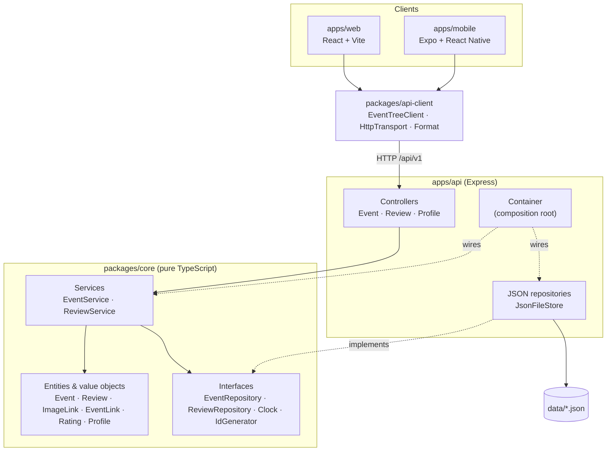

<div align="center">

# 🌳 Event Tree

### A Linktree for events. Post what's coming up, look back at what happened, share the photos, and leave a review.

One TypeScript codebase for a **web app**, a **mobile app** and the **API** behind both.


[Features](#-features) · [Tech stack](#-tech-stack) · [Architecture](#-architecture) · [Repo structure](#-repository-structure) · [OOP design](#-object-oriented-design) · [Quick start](#-quick-start) · [API](#-api-reference) · [How it was built](#-how-it-was-built)

</div>

---

## ✨ Features

| | Feature | Where |
|---|---|---|
| 🗓️ | **Upcoming / Past switch.** An event moves to Past by itself once it ends. Status is computed from the clock and never stored. | web · mobile |
| ⏳ | **Next up cards** with live countdowns, and a *Happening now* tag while an event is running | web · mobile |
| ➕ | **Post an event** with a title, category, times, venue, description, a poster image link and any number of buttons (Register, Tickets, Slides…) | web · mobile · API |
| 🖼️ | **Image links.** A cover poster plus a photo gallery that anyone can add to by pasting an image URL. Opens in a full-screen viewer. | web · mobile · API |
| ⭐ | **Reviews.** A 1–5 star rating with an optional comment, an average and a star breakdown. Reviews open once an event has started. | web · mobile · API |
| 🔎 | **Search and category chips.** Categories are read from the data. | web · mobile |
| 🔗 | **Share links.** Every event has a readable URL (`/e/devfest-on-campus`) and a share button. | web · mobile |
| 🎨 | **Theming.** Profile colours (Linktree's `theme.colors`) restyle both apps. | web · mobile |
| 🔐 | **Optional admin key** for creating, editing and deleting events. Reviews and photos stay open. | API |
| 📄 | **Zero-build page.** The original single-file Linktree-style page still works on its own. | `apps/static` |

---

## 🧰 Tech stack

| Layer | Technology | Why |
|---|---|---|
| **Language** | TypeScript 5 (strict, `noUncheckedIndexedAccess`) | One language and one set of types from the database record to the button |
| **Domain** | Plain TypeScript classes (`packages/core`) | No framework imports, so it runs in Node, the browser and React Native alike |
| **API** | Node.js ≥ 20, Express 4, `tsx` | Small, well known, and runs TypeScript directly |
| **Storage** | JSON files via `JsonFileStore` (atomic writes) | No database to install. Swap in Postgres by implementing two interfaces |
| **Web** | React 18, Vite 5, React Router 6, plain CSS with custom properties | Fast dev server, 60 KB gzipped bundle, no CSS framework |
| **Mobile** | Expo SDK 52, React Native 0.76, Expo Router 4 | One codebase for iOS and Android, file-based routes like the web app |
| **Shared client** | `@event-tree/api-client` (fetch-based) | Web and mobile call the same typed methods |
| **Tests** | Vitest | Domain rules, HTTP routes and the client are all covered |
| **Monorepo** | npm workspaces | No extra tooling needed |
| **Research** | [REA](https://github.com/morluto/rea) | Used to reverse engineer Linktree's page model ([findings](docs/reverse-engineering/linktree.md)) |

---

## 🏛️ Architecture



**Dependencies point inward.** `core` imports nothing from the other packages. The API adapts HTTP to core
services, and the apps adapt core DTOs to UI. Swapping Express, the JSON store or React touches one
layer only.

A request, end to end (posting a review):

```
ReviewForm (web)  →  EventTreeClient.addReview()  →  POST /api/v1/events/:id/reviews
  →  ReviewController.create()  →  ReviewService.add()
       ├─ event.acceptsReviews(clock.now())   ← business rule lives on the entity
       ├─ Review.create() → Rating.of(stars)  ← validation lives in value objects
       └─ ReviewRepository.save()             ← interface; JsonReviewRepository implements it
  ←  201 ReviewDTO   (or 409 BusinessRuleError → { error: { code, message } })
```

More detail in [`docs/architecture.md`](docs/architecture.md).

---

## 📁 Repository structure

```
event-tree/
├── apps/
│   ├── api/                         Express REST API
│   │   ├── src/
│   │   │   ├── config.ts            typed env config
│   │   │   ├── container.ts         composition root (dependency injection)
│   │   │   ├── server.ts            entry point
│   │   │   ├── http/
│   │   │   │   ├── Controller.ts    abstract base controller
│   │   │   │   ├── controllers/     EventController · ReviewController · ProfileController
│   │   │   │   ├── middleware.ts    error mapping · admin guard · 404
│   │   │   │   └── createApp.ts     builds the Express app (no listen, so it is testable)
│   │   │   ├── infrastructure/      JsonFileStore · Json*Repository
│   │   │   └── seed/seed.ts         loads apps/static/events.js as sample data
│   │   └── test/api.test.ts
│   │
│   ├── web/                         React + Vite web app
│   │   └── src/
│   │       ├── pages/               TreePage · EventPage · NewEventPage · NotFoundPage
│   │       ├── components/          ProfileHeader · StatusTabs · Filters · EventButton · NextUpCard
│   │       │   │                    ImageGallery · EventForm · ThemeProvider · Page
│   │       │   └── reviews/         RatingBars · ReviewForm · ReviewList · StarInput
│   │       ├── lib/                 api · useResource · SessionStore
│   │       └── styles/app.css       design tokens + Linktree measurements
│   │
│   ├── mobile/                      Expo + React Native app
│   │   ├── app/                     expo-router screens: index · e/[slug] · new · _layout
│   │   └── src/
│   │       ├── components/          EventRow · NextUpCard · Pill · Gallery · ReviewSection · Field
│   │       ├── lib/                 api · useResource
│   │       └── theme.ts             same tokens as the web app
│   │
│   └── static/                      the original zero-build page (index.html + events.js)
│       └── assets/                  hero art and event posters (also served by the API)
│
├── packages/
│   ├── core/                        🧠 domain layer, framework-free
│   │   ├── src/
│   │   │   ├── shared/              Entity · ValueObject · errors · Guard · Clock/IdGenerator ports
│   │   │   ├── events/              Event · ImageLink · EventLink · EventRepository · EventService
│   │   │   ├── reviews/             Review · Rating · RatingSummary · ReviewRepository · ReviewService
│   │   │   ├── profile/             Profile · ProfileRepository
│   │   │   ├── infrastructure/      in-memory repositories (tests, previews)
│   │   │   └── dto.ts               data shapes shared by API and apps
│   │   └── test/core.test.ts
│   │
│   └── api-client/                  🔌 typed client used by web + mobile
│       ├── src/                     EventTreeClient · HttpTransport · ApiError · Format
│       └── test/client.test.ts
│
├── docs/
│   ├── architecture.md              layers, rules, extension points
│   ├── reverse-engineering/
│   │   └── linktree.md              REA analysis of Linktree's profile page
│   └── PROGRESS.md                  build log, module by module
│
├── package.json                     npm workspaces + root scripts
└── tsconfig.base.json               shared strict compiler settings
```

---

## 🧱 Object-oriented design

The code follows standard OOP principles. Each one shows up in a specific place:

| Principle | Where it shows up |
|---|---|
| **Encapsulation** | `Event` keeps its state private. It only changes through `update()`, `addImage()` and `moveTo()`, which re-check every rule, so an `Event` can never be invalid. |
| **Abstraction** | Services depend on `EventRepository` and `ReviewRepository` interfaces, not on files or SQL. `Clock` and `IdGenerator` hide time and randomness. |
| **Inheritance** | `Entity` and `ValueObject` base classes give identity and equality. `DomainError` → `ValidationError` / `BusinessRuleError` / `NotFoundError`. `Controller` → `EventController` / `ReviewController` / `ProfileController`. |
| **Polymorphism** | `InMemoryEventRepository` and `JsonEventRepository` are interchangeable behind one interface. The error middleware maps any `DomainError` subclass to a status code with `instanceof`. |
| **Single responsibility** | `HttpTransport` only does HTTP, and `EventTreeClient` only knows endpoints. `JsonFileStore` only does atomic file I/O; repositories only map records to entities. |
| **Open/closed** | Add a storage backend by adding a class, with no change to services. Add an endpoint by adding a controller to the list in `createApp`. |
| **Dependency inversion** | `Container` is the only place that picks concrete classes. Tests build the same graph with in-memory repositories and a `FixedClock`. |
| **Value objects** | `ImageLink` (http/https only), `EventLink` (typed `kind`) and `Rating` (whole stars 1–5) validate themselves and are immutable. |

---

## 🚀 Quick start

**Needs** Node.js 20.12 or newer and npm 10. For mobile, also install the Expo Go app on a phone, or an emulator.

```bash
npm install            # installs every workspace
npm run seed           # loads 8 sample events + reviews into apps/api/data/
npm run dev:api        # http://localhost:4000/api/v1
npm run dev:web        # http://localhost:5173  (second terminal)
npm run dev:mobile     # Expo dev server; press i / a, or scan the QR code with Expo Go
```

| Command | What it does |
|---|---|
| `npm test` | Runs the core, api-client and API test suites |
| `npm run typecheck` | Runs `tsc` in every workspace |
| `npm run build:web` | Production build to `apps/web/dist` |
| `npm run seed -- --force` | Wipes the data and re-seeds |

### Configuration

| File | Variable | Default | Purpose |
|---|---|---|---|
| `apps/api/.env` | `PORT` | `4000` | API port |
| | `PUBLIC_URL` | `http://localhost:4000` | Used to build poster links when seeding |
| | `ADMIN_KEY` | *(empty)* | When set, creating, editing and deleting events needs `x-admin-key` |
| | `CORS_ORIGINS` | `*` | Comma-separated list of allowed origins |
| `apps/web/.env` | `VITE_API_URL` | *(same origin)* | API location in production |
| `apps/mobile/.env` | `EXPO_PUBLIC_API_URL` | `http://localhost:4000` | Android emulator: `http://10.0.2.2:4000`. Phone: your computer's LAN IP |

> **Testing on a real phone:** start the API with `PUBLIC_URL=http://<LAN-IP>:4000`, then re-seed so the poster links point to an address the phone can reach.

---

## 📡 API reference

Base path: **`/api/v1`**. Errors always look like `{ "error": { "code", "message", "field?" } }`.

| Method | Path | Body | Auth | Returns |
|---|---|---|---|---|
| `GET` | `/profile` | | | `ProfileDTO` |
| `PUT` | `/profile` | `ProfileDTO` | admin | `ProfileDTO` |
| `GET` | `/categories` | | | `string[]` |
| `GET` | `/events?when=upcoming\|past\|all&category=&q=&limit=` | | | `EventDTO[]` |
| `GET` | `/events/:idOrSlug` | | | `EventDTO` |
| `POST` | `/events` | `CreateEventInput` | admin | `201 EventDTO` |
| `PATCH` | `/events/:idOrSlug` | `Partial<CreateEventInput>` | admin | `EventDTO` |
| `DELETE` | `/events/:idOrSlug` | | admin | `204` |
| `POST` | `/events/:idOrSlug/images` | `{ url, alt?, caption? }` | | `201 EventDTO` |
| `GET` | `/events/:idOrSlug/reviews` | | | `ReviewDTO[]` (newest first) |
| `GET` | `/events/:idOrSlug/reviews/summary` | | | `{ count, average, distribution }` |
| `POST` | `/events/:idOrSlug/reviews` | `{ authorName, rating, comment? }` | | `201 ReviewDTO` |

Status codes: `400` validation · `401` missing or wrong admin key · `404` not found · `409` business rule (e.g. reviewing an event that hasn't started).

<details>
<summary>Example: post an event</summary>

```bash
curl -X POST http://localhost:4000/api/v1/events \
  -H "content-type: application/json" \
  -d '{
    "title": "Robotics Demo Day",
    "category": "Tech",
    "startsAt": "2026-12-10T10:00:00+03:00",
    "endsAt":   "2026-12-10T13:00:00+03:00",
    "venue": "Innovation Lab",
    "coverImage": { "url": "https://images.example.com/robotics.jpg", "alt": "Robot arm on stage" },
    "links": [{ "label": "Register", "url": "https://forms.example.com/robotics", "kind": "register", "primary": true }]
  }'
```
</details>

---

## 🔍 Reverse engineering Linktree

The data model comes from studying a live Linktree profile with [REA](https://github.com/morluto/rea):
the page's Next.js `__NEXT_DATA__` plus a static analysis of its JavaScript chunks (355 modules, versioned
`/v1/` REST routes, GraphQL form submissions). Linktree's `links[]` became `Event`, `thumbnail` became
`ImageLink`, `scheduleStart` became derived status, and form submissions became reviews. The full field
mapping and evidence are in **[docs/reverse-engineering/linktree.md](docs/reverse-engineering/linktree.md)**.

---

## 🪜 How it was built

Each module was built and tested before the next one started. Each has its own commit, and the
details are in [`docs/PROGRESS.md`](docs/PROGRESS.md).

```
0 Research ─▶ 1 Repo root ─▶ 2 core ─▶ 3 api ─▶ 4 api-client ─▶ 5 web ─▶ 6 mobile ─▶ 7 docs
   REA          workspaces     domain    HTTP     shared client   React    Expo       README
```

## 🗺️ Roadmap

- [ ] Postgres repository (`PgEventRepository` behind the same interface)
- [ ] User accounts so people can edit their own events and reviews
- [ ] Image uploads to object storage (the domain already stores links, so only the input changes)
- [ ] Rate limiting on review and photo endpoints (the client already reads `Retry-After`)
- [ ] Push reminders before an event starts (Expo Notifications)
- [ ] `.ics` calendar export, ported from `apps/static`

## 📄 License

[MIT](LICENSE)
