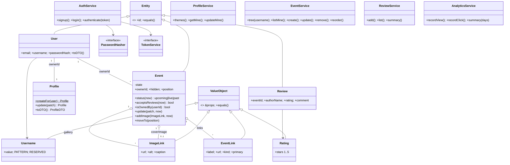

# Architecture

Event Tree is multi-tenant: every host has an account, a profile (their public page at `/:username`)
and their own events. Visitors need no account to browse, add photos or leave reviews.

## Layers

| Layer | Package | Knows about | Never imports |
|---|---|---|---|
| Domain | `packages/core` | Users, profiles, events, reviews, analytics, rules | Express, React, `fs`, `fetch`, `node:crypto` |
| Adapters (server) | `apps/api` | HTTP, JSON files, env vars, scrypt and HMAC | React |
| Adapter (client) | `packages/api-client` | HTTP, bearer tokens, DTO types | Entities, Express |
| UI | `apps/web`, `apps/mobile` | Components, DTOs, the client | Entities, repositories |

Apps only see **DTOs** (`EventDTO`, `ProfileDTO`, `TreeDTO`…), never entity instances. Entities exist only
inside a service call: restored from a record, changed through methods, saved back as a record.

## Domain model

## Business rules and where they live

| Rule | Enforced in |
|---|---|
| Usernames are 3–30 characters of `a-z 0-9 . _`, lowercase, and can't be an app route (`admin`, `login`, `signup`, `api`…) | `Username.of` |
| Emails and usernames are unique | `AuthService.signup` → `ConflictError` (409) |
| Passwords are at least 8 characters and stored only as scrypt hashes | `AuthService.signup`, `ScryptPasswordHasher` |
| A host can only change their own events | `EventService` → `event.isOwnedBy()` else `ForbiddenError` (403) |
| Hidden events are left off the public page, and their links, clicks and reviews return 404 | `EventService.tree` / `getPublic` |
| A new event goes to the top of the host's page | `EventService.create` |
| Picking a theme resets colours, buttons and font; changing a colour switches to "custom" | `Profile.update` |
| Colours are hex, button styles and fonts come from fixed lists | `Profile.validateAppearance` |
| An event ends after it starts | `Event.validate` |
| Status (upcoming, live, past) is derived from the clock and never stored | `Event.status(now)` |
| Reviews open once an event has started | `Event.acceptsReviews` → `ReviewService.add` |
| Image, button and social links must be `http(s)` (blocks `javascript:` and similar) | `Guard.httpUrl` |
| Ratings are whole stars from 1 to 5 | `Rating.of` |
| A gallery holds at most 24 images, with no duplicates | `Event.addImage` |
| Slugs are unique per host (`title`, `title-2`, …) | `EventService.uniqueSlug` |
| Analytics keeps counts only: type, owner, event and time. No IPs, cookies or user agents | `AnalyticsService` |

## Authentication

1. `POST /auth/signup` or `/auth/login` returns `{ token, user }`.
2. The token is `base64url({ sub, exp })` + `.` + an HMAC-SHA256 signature with `AUTH_SECRET`. It lasts
   30 days and needs no session table.
3. The web app keeps it in `localStorage` (`BrowserStore`); the mobile app keeps it in memory.
   `EventTreeClient` reads it through a `getToken()` callback and sends `Authorization: Bearer`.
4. `AuthenticatedController.requireUser()` calls `AuthService.authenticate()`, which checks the
   signature and expiry and loads the user, or throws `UnauthorizedError` (401).

## The web app

| Route | Screen |
|---|---|
| `/` | Landing: claim form, a live demo page in a phone frame, feature bands, examples |
| `/signup`, `/login` | Two-step sign-up with a live username check; log in |
| `/admin` | Events: add, edit, show/hide, reorder, delete |
| `/admin/appearance` | Profile, theme, button style, font, colours, social icons |
| `/admin/analytics` | Views, clicks, click rate, per-day chart with table view, most-clicked events |
| `/:username` | The public page (`TreeView`) |
| `/:username/:slug` | One event, styled with its host's theme |

`AdminLayout` shows the editor beside a `PhoneFrame` iframe of the real public page with `?preview=1`.
Preview mode doesn't record views or clicks. Each save bumps a `v` query parameter, which reloads the frame.

Theming works through CSS variables. `appearanceStyle()` turns a host's appearance into `--t-bg`,
`--t-text`, `--t-card`, `--t-card-text`, `--t-accent` and `--t-font`, and `styles/tree.css` reads only
those. A button style is a modifier class (`ticket--pill`, `ticket--outline`…) on the same markup.

## Extension points

- **New storage.** Implement the repository interfaces (`UserRepository`, `ProfileRepository`,
  `EventRepository`, `ReviewRepository`, `AnalyticsRepository`), then change `Container.fromConfig`.
- **New theme.** Add an entry to `profile/themes.ts`. It appears in the dashboard automatically.
- **New button style.** Add it to `ButtonStyle` in `dto.ts`, the list in `Profile`, and a `.ticket--name` block in `tree.css`.
- **New endpoint.** Subclass `Controller` (or `AuthenticatedController`), declare routes in `register()`, and add it to the list in `createApp`.
- **New client** (CLI, bot, another app). Create an `EventTreeClient` with any `fetch` and a `getToken`.

## Error flow

`DomainError` subclasses carry a `code`. `errorHandler` maps them to status codes: `ValidationError` → 400,
`UnauthorizedError` → 401, `ForbiddenError` → 403, `NotFoundError` → 404, `ConflictError` and
`BusinessRuleError` → 409. Unknown errors are logged and returned as a generic 500. On the client,
`HttpTransport` turns every non-2xx response into an `ApiError` with the same `code` and `field`, and a
network failure becomes status `0`.
