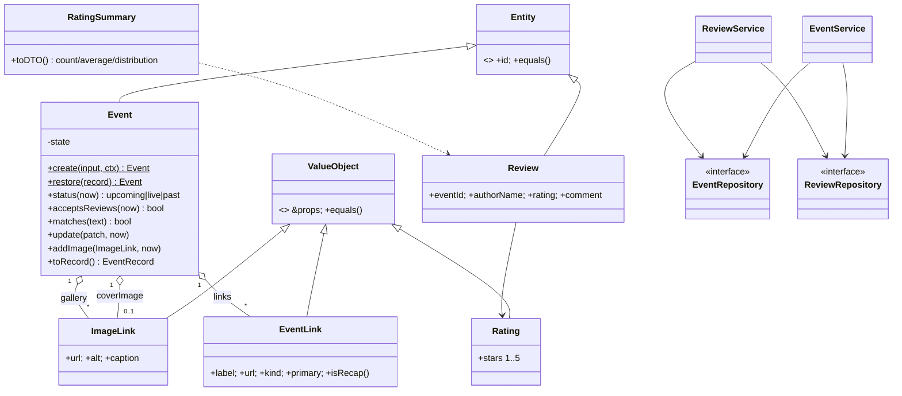

# Architecture

## Layers

| Layer | Package | Knows about | Never imports |
|---|---|---|---|
| Domain | `packages/core` | Events, reviews, images, profiles, rules | Express, React, `fs`, `fetch` |
| Adapters (server) | `apps/api` | HTTP, JSON files, env vars | React |
| Adapter (client) | `packages/api-client` | HTTP, DTO types | Entities, Express |
| UI | `apps/web`, `apps/mobile` | Components, DTOs, the client | Entities, repositories |

Apps only see **DTOs** (`EventDTO`, `ReviewDTO`…), never entity instances. Entities exist only inside a
service call: restored from a record, changed through methods, saved back as a record.

## Domain model

## Business rules and where they live

| Rule | Enforced in |
|---|---|
| An event ends after it starts | `Event.validate` |
| Status (upcoming, live, past) is derived from the clock and never stored | `Event.status(now)` |
| Reviews open once an event has started | `Event.acceptsReviews` → `ReviewService.add` |
| Image and button links must be `http(s)` (blocks `javascript:` and similar) | `Guard.httpUrl` via `ImageLink` and `EventLink` |
| Ratings are whole stars from 1 to 5 | `Rating.of` |
| A gallery holds at most 24 images, with no duplicates | `Event.addImage` |
| Slugs are unique (`title`, `title-2`, …) | `EventService.uniqueSlug` |
| Deleting an event deletes its reviews | `EventService.remove` |

## Extension points

- **New storage.** Implement `EventRepository`, `ReviewRepository` and `ProfileRepository`, then change
  `Container.fromConfig`. Nothing else moves.
- **New endpoint.** Subclass `Controller`, declare routes in `register()`, and add it to the list in `createApp`.
- **New client** (CLI, bot, another app). Create an `EventTreeClient` with any `fetch`.
- **Auth.** Replace `adminGuard` with real middleware. Services take no user today, so add an `actor`
  parameter where ownership matters.

## Error flow

`DomainError` subclasses carry a `code`. `errorHandler` maps them to status codes
(`ValidationError` → 400, `NotFoundError` → 404, `BusinessRuleError` → 409). Unknown errors are logged and
returned as a generic 500. On the client, `HttpTransport` turns every non-2xx response into an `ApiError`
with the same `code` and `field`, and a network failure becomes status `0`.
